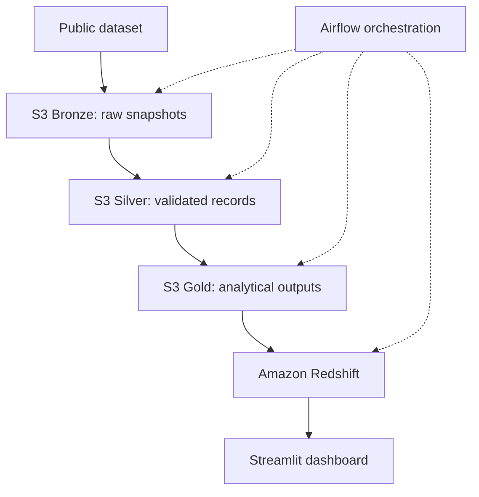

# CloudFlow Analytics
### Cloud-Native ETL & BI Pipeline

An end-to-end data engineering project designed to turn public datasets into reliable, business-ready analytics through a reproducible cloud pipeline.

> **Status: planning / implementation not started.** This README defines the target architecture and development roadmap. The repository currently has no runnable pipeline, infrastructure, or dashboard. All capabilities below are planned unless explicitly marked complete.

## Project goal

Build a platform that ingests public data, preserves raw source records, validates and transforms them, loads an analytical warehouse, and serves metrics through a dashboard. The project will demonstrate data modeling, orchestration, incremental processing, cloud infrastructure, and operational monitoring.

The initial use case will be **e-commerce order analytics**, subject to selecting a suitable public dataset and checking its license. Transit ridership is an alternative use case, not an additional MVP requirement.

## MVP scope

- Ingest one documented public dataset into an AWS S3 landing zone.
- Transform records through Bronze, Silver, and Gold layers.
- Schedule daily batches with Apache Airflow.
- Support repeatable loads, backfills, and a documented incremental strategy.
- Load curated analytical tables into Amazon Redshift.
- Build a Streamlit dashboard for metrics, trends, and anomaly flags.
- Provision cloud infrastructure with Terraform.
- Document data lineage, quality checks, deployment, and measured cloud costs.

**Initial stack decision:** Python ETL packaged for AWS Glue, S3, Airflow in Docker, Redshift, Terraform, SQL, and Streamlit. Lambda-based ETL, Snowflake, and Power BI are alternative implementations to evaluate later; they are not all required for the first version.

## Target architecture



Python ETL jobs will perform the transformations. Terraform will manage the AWS resources. Airflow will coordinate job execution, retries, validation, and warehouse loads.

## Planned technology stack

| Component | Technology | Responsibility |
| --- | --- | --- |
| Object storage | AWS S3 | Raw snapshots and curated data |
| Processing | Python, AWS Glue | Cleaning, deduplication, transformation |
| Scheduling | Apache Airflow, Docker | Daily runs, dependencies, backfills |
| Warehouse | Amazon Redshift, SQL | Facts, dimensions, analytical queries |
| Dashboard | Streamlit | Metrics, trends, anomaly exploration |
| Infrastructure | Terraform, IAM | Reproducible resources and scoped access |
| Verification | pytest, SQL checks | Transformation and data-quality tests |

## Data contract and processing rules

Before implementation, record the dataset URL, license, schema, update frequency, and sample records in `docs/data-source.md`.

The minimum e-commerce contract should include an order identifier, order timestamp, status, and monetary amount. Customer, product, and line-item fields depend on the selected source.

| Layer | Planned contents | Rules |
| --- | --- | --- |
| Bronze | Original source snapshots plus ingestion metadata | Preserve source values; record source, batch ID, checksum, and ingestion time |
| Silver | Typed and normalized records | Validate required fields, normalize timestamps/currency, deduplicate at the declared grain, quarantine invalid rows |
| Gold | Facts, dimensions, and aggregates | Declare table grain and business definitions; reconcile aggregates with Silver |

Daily scheduling does not imply that the source supports daily incremental extraction. Use a source update watermark when available. For static datasets, simulate daily arrivals by partitioning historical data and label the simulation clearly.

Advance a watermark only after a successful load. Reprocessing a batch must not duplicate warehouse records. Define handling for late arrivals, cancellations, refunds, and updated orders before implementing merge logic.

## Planned analytical model

Start with `fact_orders` at one row per order and `dim_date`. Add `dim_customer`, `dim_product`, and a separate `fact_order_items` only if the source supports them. Avoid duplicating order totals when joining line items.

Planned dashboard metrics:

- Order count and revenue over time.
- Average order value and cancellation rate.
- Product/category breakdowns when available.
- Data freshness, rejected-row counts, and last successful load.
- Explainable anomaly flags based on documented thresholds or rolling baselines.

Revenue and order-status definitions must be documented before the first dashboard is accepted. Anomaly flags are exploratory signals, not confirmed incidents.

## Proposed repository structure

These directories are a blueprint and do not exist yet.

| Path | Planned contents |
| --- | --- |
| `src/cloudflow/ingestion/` | Source adapters and ingestion metadata |
| `src/cloudflow/transforms/` | Bronze-to-Silver and Silver-to-Gold logic |
| `src/cloudflow/quality/` | Validation and quarantine rules |
| `dags/` | Airflow DAGs |
| `sql/` | Warehouse schema, merge logic, analytical queries |
| `dashboard/` | Streamlit application |
| `infra/terraform/` | AWS resources and environment configuration |
| `tests/` | Fixtures, unit tests, integration tests |
| `docs/` | Architecture, data contract, lineage, runbook, costs |
| `docker/` | Container definitions |
| `compose.yaml` | Future local development services |
| `.env.example` | Future configuration template without secrets |

## Getting started now

Only the clone steps are currently executable:

```bash
git clone https://github.com/houssamb4/cloudflow-analytics.git
cd cloudflow-analytics
git switch -c feat/local-pipeline
```

The repository is private, so cloning requires an authorized GitHub account.

### First implementation milestone

1. Select the public dataset and document its license and data contract.
2. Create a Python package, dependency lock file, and the proposed test directories.
3. Add a small redistributable or synthetic fixture.
4. Implement a local pipeline that reads the fixture and writes Bronze, Silver, and Gold outputs.
5. Test deduplication, invalid-row handling, and repeated execution.
6. Add actual setup and run commands to this README once the corresponding files exist.

Start with local files and DuckDB for transformation/query validation. This is a development substitute; Redshift SQL and loading behavior will need separate integration tests.

Planned tooling: Git, Python, Docker with Compose, Terraform, and AWS CLI. Pin compatible versions during scaffolding. Cloud credentials are not required for the first local milestone.

## Development roadmap

- [ ] **1 — Local vertical slice:** dataset contract, sample ingestion, transformations, quality checks, repeatable output.
- [ ] **2 — Orchestration:** containerized Airflow, daily DAG, retries, backfills, failure reporting.
- [ ] **3 — AWS foundation:** Terraform-managed storage, IAM, networking, and warehouse; documented remote state.
- [ ] **4 — Cloud processing:** Glue jobs, incremental state, quarantine, and Redshift loading.
- [ ] **5 — Analytics:** star schema, reconciled metrics, Streamlit dashboard, anomaly rules.
- [ ] **6 — Delivery evidence:** CI checks, architecture and lineage diagrams, screenshots, runbook, cost measurements.

## Acceptance criteria

The MVP is ready when one documented dataset flows from ingestion to the dashboard, repeated loads produce no duplicates, invalid records are traceable, and a failed batch can be rerun safely. A backfill must be demonstrated, dashboard totals must reconcile with warehouse queries, and deployment/teardown steps must be reproducible.

## Operations and cost plan

Use private buckets, least-privilege IAM roles, encrypted storage, and credentials supplied through the environment or an appropriate secrets service. Never commit credentials, Terraform state, local environment files, or non-redistributable datasets.

Track batch IDs, row counts, duration, failures, freshness, and warehouse reconciliation results. Keep a runbook for failed loads and schema changes.

Before deploying, document region, resource sizing, expected runtime, and estimated costs in `docs/costs.md`. Configure budget alerts and a cleanup procedure; alerts do not impose a spending cap. Measure actual costs during a limited demonstration deployment and remove unused resources afterward.

## Future extensions

Power BI reporting, Snowflake as a warehouse alternative, Lambda for suitably small ingestion tasks, additional data sources, and more advanced anomaly detection.

## License

No project license has been selected yet. Dataset licenses must be documented separately.
