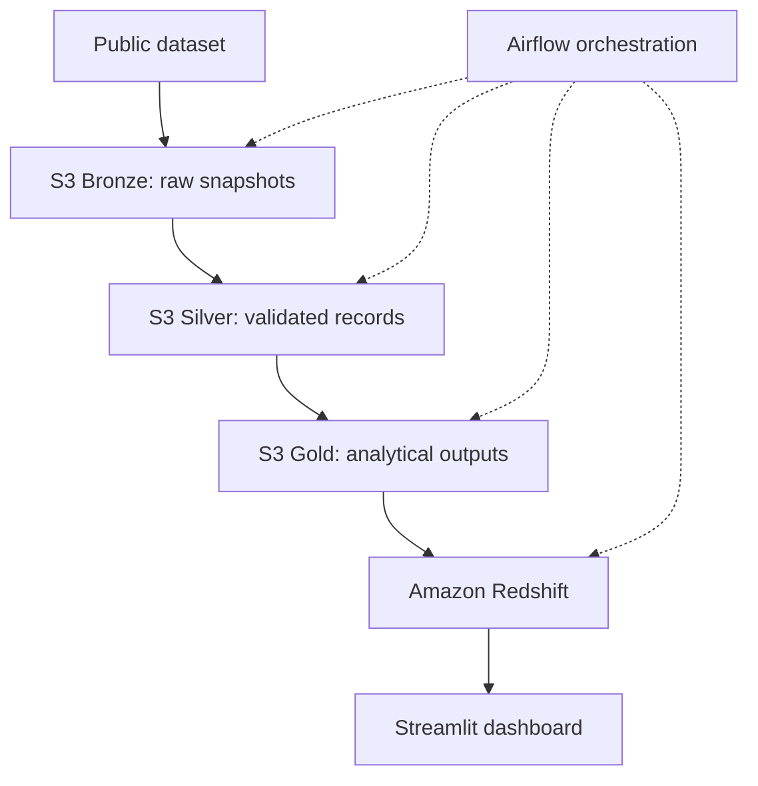

# CloudFlow Analytics
### Cloud-Native ETL, BI & Data Reliability Platform

An end-to-end data engineering project designed to turn public datasets into reliable, business-ready analytics through a reproducible cloud pipeline.

> **Status: MVP milestone 1 (local vertical slice): implemented locally**. The repository has a tested, quality-gated Python/DuckDB pipeline using synthetic Olist fixtures. Cloud infrastructure, orchestration, and dashboards remain planned; only roadmap item 1 is implemented.

## Project goal

Build a platform that ingests public data, preserves raw source records, validates and transforms them, loads an analytical warehouse, and serves metrics through a dashboard. The project will demonstrate data modeling, orchestration, incremental processing, cloud infrastructure, and operational monitoring.

The initial use case is **e-commerce order analytics** based on the Olist Brazilian e-commerce schema (CC BY-NC-SA 4.0). The local milestone uses only independently authored synthetic fixtures; no public dataset has been downloaded. See [the source and data contract](docs/data-source.md). Transit ridership is an alternative use case, not an additional MVP requirement.

## MVP scope

- Ingest one documented public dataset into an AWS S3 landing zone.
- Transform records through Bronze, Silver, and Gold layers.
- Schedule daily batches with Apache Airflow.
- Support repeatable loads, backfills, and a documented incremental strategy.
- Load curated analytical tables into Amazon Redshift.
- Build a Streamlit dashboard for metrics, trends, and anomaly flags.
- Provide a data reliability console with quality gates, lineage, freshness indicators, and controlled recovery.
- Provision cloud infrastructure with Terraform.
- Document data lineage, quality checks, deployment, and measured cloud costs.

**Initial stack decision:** Python ETL packaged for AWS Glue, S3, Airflow in Docker, Redshift, Terraform, SQL, and Streamlit. Lambda-based ETL, Snowflake, and Power BI are alternative implementations to evaluate later; they are not all required for the first version.

## Target architecture



Python ETL jobs will perform the transformations. Terraform will manage the AWS resources. Airflow will coordinate job execution, retries, validation, and warehouse loads.

## Planned technology stack

| Component | Technology | Responsibility |
| --- | --- | --- |
| Object storage | AWS S3 | Raw snapshots and curated data |
| Processing | Python, AWS Glue | Cleaning, deduplication, transformation |
| Scheduling | Apache Airflow, Docker | Daily runs, dependencies, backfills |
| Warehouse | Amazon Redshift, SQL | Facts, dimensions, analytical queries |
| Dashboard | Streamlit | Metrics, trends, anomaly exploration |
| Infrastructure | Terraform, IAM | Reproducible resources and scoped access |
| Verification | pytest, SQL checks | Transformation and data-quality tests |

## Data contract and processing rules

The selected dataset URL, license, local subset schema, simulated arrivals, sample records, quality rules, and revenue definitions are documented in [docs/data-source.md](docs/data-source.md). The layer contract below is implemented locally; the cloud destinations remain planned.

The minimum e-commerce contract should include an order identifier, order timestamp, status, and monetary amount. Customer, product, and line-item fields depend on the selected source.

| Layer | Planned contents | Rules |
| --- | --- | --- |
| Bronze | Original source snapshots plus ingestion metadata | Preserve source values; record source, batch ID, checksum, and ingestion time |
| Silver | Typed and normalized records | Validate required fields, normalize timestamps/currency, deduplicate at the declared grain, quarantine invalid rows |
| Gold | Facts, dimensions, and aggregates | Declare table grain and business definitions; reconcile aggregates with Silver |

Daily scheduling does not imply that the source supports daily incremental extraction. Use a source update watermark when available. For static datasets, simulate daily arrivals by partitioning historical data and label the simulation clearly.

Advance a watermark only after a successful load. Reprocessing a batch must not duplicate warehouse records. Define handling for late arrivals, cancellations, refunds, and updated orders before implementing merge logic.

## Planned analytical model

Start with `fact_orders` at one row per order and `dim_date`. Add `dim_customer`, `dim_product`, and a separate `fact_order_items` only if the source supports them. Avoid duplicating order totals when joining line items.

Planned dashboard metrics:

- Order count and revenue over time.
- Average order value and cancellation rate.
- Product/category breakdowns when available.
- Data freshness, rejected-row counts, and last successful load.
- Explainable anomaly flags based on documented thresholds or rolling baselines.

Revenue and order-status definitions must be documented before the first dashboard is accepted. Anomaly flags are exploratory signals, not confirmed incidents.

## Standout feature: data reliability and recovery console

Build a Streamlit operations view that answers **“Can I trust this dashboard?”** for each metric.

| Capability | Planned behavior |
| --- | --- |
| Metric provenance | Show the source dataset, transformation version, upstream tables, batch ID, and last successful publication |
| Quality checks | Detect duplicate order IDs, missing required fields/prices, and unexpected row counts using documented thresholds |
| Quarantine | Preserve rejected records with rule IDs, reasons, and source/batch references |
| Run history | Show execution status, check results, row counts, duration, and retry attempts |
| Impact tracing | Map a failed table or batch to affected metrics using explicit lineage metadata |
| Freshness | Label metrics as current, stale, or unavailable; expose data age and freshness targets |
| Controlled recovery | Allow authorized operators to retry a failed batch and inspect its outcome |

### Publication and recovery contract

Write candidate outputs into a staging area and run quality checks before publication. Separate warning-only rules from blocking rules. A blocking failure must prevent the entire affected reporting snapshot from replacing the last validated snapshot. If no validated snapshot exists, show an unavailable state rather than empty totals presented as valid data.

Record runs, quality results, rejected-row references, lineage edges, and publication versions in persistent metadata tables. Advance incremental watermarks only after publication succeeds. Publish a consistent snapshot so the dashboard cannot mix tables from different batches.

Expose recovery through an authenticated backend integration with Airflow, with scoped permissions, an audit record, and protection against concurrent retries. Do not expose cloud credentials or arbitrary command execution in the dashboard. A corrected source creates a new immutable input version linked to the failed run. Retrying the same input remains idempotent.

### Demonstration and acceptance tests

1. Load a clean sample and publish the first validated dashboard snapshot.
2. Submit a fixture containing duplicate IDs and missing prices; trigger a blocking check.
3. Inspect the failed run, quarantined records, and affected dashboard metrics.
4. Verify that the dashboard retains the previous snapshot and shows a freshness warning.
5. Correct the fixture and trigger an authorized rerun.
6. Verify reconciliation, an updated publication timestamp, and no duplicates after repeating the run.

Also demonstrate an unexpected row-count warning. Begin with deterministic checks and explicit lineage mappings; automated lineage discovery and learned anomaly thresholds can follow later.

## Proposed repository structure

The Python package, tests, and data-source documentation now exist. The remaining paths are the blueprint for later milestones; no Airflow, dashboard, or infrastructure has been scaffolded.

| Path | Contents (local implementation or future blueprint) |
| --- | --- |
| `src/cloudflow/ingestion/` | Source adapters and ingestion metadata |
| `src/cloudflow/transforms/` | Bronze-to-Silver and Silver-to-Gold logic |
| `src/cloudflow/quality/` | Validation and quarantine rules |
| `dags/` | Airflow DAGs |
| `sql/` | Warehouse schema, merge logic, analytical queries |
| `dashboard/` | Streamlit analytics and reliability console |
| `src/cloudflow/observability/` | Run metadata, lineage, publication state, recovery integration |
| `infra/terraform/` | AWS resources and environment configuration |
| `tests/` | Fixtures, unit tests, integration tests |
| `docs/` | Architecture, data contract, lineage, runbook, costs |
| `docker/` | Container definitions |
| `compose.yaml` | Future local development services |
| `.env.example` | Future configuration template without secrets |

## Getting started locally

Requires **Python 3.11+**. Run from the repository root. The local application depends only on pinned pandas and DuckDB, with pytest for tests (their transitive dependencies are captured in `uv.lock`). No Docker, cloud credentials, or dataset download is needed.

```bash
git clone https://github.com/houssamb4/cloudflow-analytics.git
cd cloudflow-analytics
git switch feat/local-pipeline

# With uv: reproducible dependency versions and hashes from uv.lock
uv sync --extra test --locked
source .venv/bin/activate

python -m pytest
python -m cloudflow.run
```

The repository is private, so cloning requires an authorized GitHub account. If uv is unavailable, use standard packaging tooling instead (direct dependencies remain pinned, but transitive dependencies are not locked by pip):

```bash
python3 -m venv .venv
source .venv/bin/activate
python -m pip install -e '.[test]'
python -m pytest
python -m cloudflow.run
```

The default run ingests `tests/fixtures/clean/` into the ignored file `local/cloudflow.duckdb`. JSON output includes run ID, immutable batch ID, status, check results, row counts, and publication ID. Exit codes: `0` published (including a no-op rerun), `2` blocked, `1` execution/input failure. Rerunning the same input creates a new audit attempt but no duplicate data or new publication version.

### Failure and correction demonstration

Use the same database for all three batches:

```bash
python -m cloudflow.run --input-dir tests/fixtures/clean --database local/demo.duckdb
python -m cloudflow.run --input-dir tests/fixtures/invalid --database local/demo.duckdb
# Expected exit 2: duplicates and missing price block publication.
# Copy run_id from the blocked run's JSON output:
python -m cloudflow.run --input-dir tests/fixtures/corrected --database local/demo.duckdb --retry-of <blocked-run-id>
python -m cloudflow.run --input-dir tests/fixtures/corrected --database local/demo.duckdb
```

The blocked attempt preserves the previous Silver/Gold snapshot and publication timestamp, while retaining raw inputs, quarantine, and checks. Correction publishes five unique orders, including a late-delivered update. Growth from three to five orders triggers the warning-only row-count check; it does not block recovery. The final retry is idempotent. Use a fresh database filename to restart the demonstration; no destructive reset command is needed.

All layers are tables inside one DuckDB file:

| Schema/tables | Purpose |
| --- | --- |
| `bronze.orders`, `order_items`, `customers`, `products`, `batches`, `files` | Immutable raw records, ingestion metadata, and original CSV bytes |
| `staging.orders`, `order_items`, `customers`, `products`, `fact_orders`, `dim_date` | Latest candidate validated before publication |
| `silver.orders`, `order_items`, `customers`, `products` | Last validated normalized snapshot |
| `silver.quarantine` | Invalid rows, reasons, rule IDs, and batch/run references |
| `gold.fact_orders`, `dim_date` | One row per order; one row per local purchase date; BRL integer cents |
| `observability.runs`, `check_results`, `publications`, `publication`, `table_contracts` | Attempts, quality results, version history/current state, and declared grains |

Inspect outputs with the installed Python DuckDB package:

```bash
python - <<'PY'
import duckdb
with duckdb.connect('local/cloudflow.duckdb', read_only=True) as db:
    print(db.sql('SELECT * FROM gold.fact_orders ORDER BY order_id'))
    print(db.sql('SELECT * FROM observability.runs ORDER BY started_at'))
PY
```

An empty `observability.publication` table means no validated output is available. Do not interpret initially empty Gold tables as valid zero metrics. The local runner is single-writer, does not implement an authenticated recovery service, and makes no AWS calls. DuckDB is a development substitute; Redshift SQL/loading behavior and all later roadmap milestones still need separate implementation and integration tests.

## Development roadmap

- [x] **1 — Local vertical slice:** dataset contract, synthetic sample ingestion, Bronze/Silver/Gold transforms, blocking/warning checks, atomic publication, quarantine, and idempotent reruns.
- [ ] **2 — Orchestration:** containerized Airflow, daily DAG, retries, backfills, failure reporting.
- [ ] **3 — AWS foundation:** Terraform-managed storage, IAM, networking, and warehouse; documented remote state.
- [ ] **4 — Cloud processing:** Glue jobs, incremental state, quarantine, and Redshift loading.
- [ ] **5 — Analytics and reliability:** star schema, reconciled metrics, Streamlit dashboard, run history, quality gates, lineage, freshness, controlled reruns.
- [ ] **6 — Delivery evidence:** CI checks, architecture and lineage diagrams, screenshots, runbook, cost measurements.

## Acceptance criteria

The MVP is ready when one documented dataset flows from ingestion to the dashboard, repeated loads produce no duplicates, invalid records are traceable, and a failed batch can be rerun safely. The failure-and-recovery demonstration must preserve the last validated snapshot, enforce operator permissions, and prove duplicate-free retries. A backfill must be demonstrated, dashboard totals must reconcile with warehouse queries, and deployment/teardown steps must be reproducible.

## Operations and cost plan

Use private buckets, least-privilege IAM roles, encrypted storage, and credentials supplied through the environment or an appropriate secrets service. Never commit credentials, Terraform state, local environment files, or non-redistributable datasets.

Track batch IDs, row counts, duration, failures, freshness, and warehouse reconciliation results. Keep a runbook for failed loads and schema changes.

Before deploying, document region, resource sizing, expected runtime, and estimated costs in `docs/costs.md`. Configure budget alerts and a cleanup procedure; alerts do not impose a spending cap. Measure actual costs during a limited demonstration deployment and remove unused resources afterward.

## Future extensions

Power BI reporting, Snowflake as a warehouse alternative, Lambda for suitably small ingestion tasks, additional data sources, and more advanced anomaly detection.

## License

No project license has been selected yet. Dataset licenses must be documented separately.
